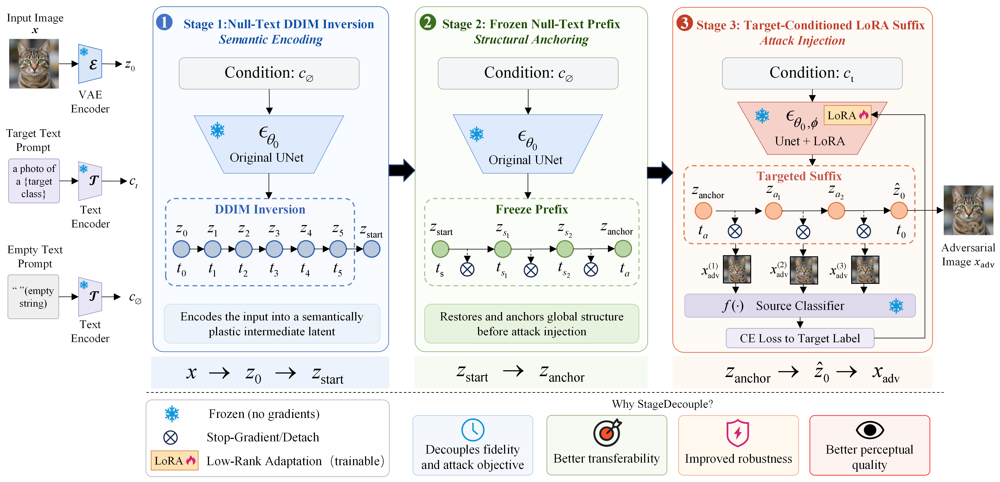

# 📰 When to Inject the Target: Stage-Decoupled Guidance for Diffusion-Based Targeted Adversarial Attacks


## 📌 Method Overview


<div align="center">
  
  <br>
  <em>Figure 1: Overall architecture of SDTI framework.</em>
</div>

---


## 📂 Datasets
<div align="center">

| Dataset | Usage | Link | Notes |
|---------|-------|------|-------|
| **ImageNet** | Training | [Download](https://image-net.org/download.php) | Full training set |
| **ImageNet-NeurIPS** | Testing | [Kaggle](https://www.kaggle.com/c/nips-2017-non-targeted-adversarial-attack) | Standard adversarial benchmark |
| **MSCOCO val2017** | Testing   | [Download](http://images.cocodataset.org/zips/val2017.zip) | Cross-domain evaluation |

</div>

## 🧠 Victim Models

We evaluate SDTI against a diverse set of victim models spanning multiple architectures:

<details>
<summary><b>CNN-based Models (7)</b></summary>

- [Inception-v3](https://huggingface.co/litert-community/inception_v3/tree/main)
- [Inception-v4](https://huggingface.co/timm/inception_v4.tf_in1k/tree/main)
- [ResNet-152](https://huggingface.co/litert-community/resnet152)
- [Inception-ResNet-v2](https://huggingface.co/timm/inception_resnet_v2.tf_in1k/tree/main)
- [DenseNet-121](https://download.pytorch.org/models/densenet121-a639ec97.pth)
- [GoogleNet](https://download.pytorch.org/models/googlenet-1378be20.pth)
- [VGG-16](https://huggingface.co/timm/vgg16.tv_in1k/tree/main)

</details>

<details>
<summary><b>Transformer-based Models (4)</b></summary>

- [ViT-B/16](https://huggingface.co/google/vit-base-patch16-224/tree/main)
- [DeiT-B](https://huggingface.co/facebook/deit-base-distilled-patch16-224/tree/main)
- [Swin-T](https://huggingface.co/microsoft/swin-tiny-patch4-window7-224)
- [Swin-B](https://huggingface.co/microsoft/swin-base-patch4-window7-224/tree/main)
</details>

<details>
<summary><b>MLP-based Models (3)</b></summary>

- [CycleMLP](https://github.com/ShoufaChen/CycleMLP?tab=readme-ov-file)
- [Mixer-B/16](https://huggingface.co/timm/mixer_b16_224.goog_in21k_ft_in1k/tree/main)
- [Mixer-L/16](https://huggingface.co/timm/mixer_l16_224.goog_in21k_ft_in1k)
</details>

## 🧪 Surrogate Models

Surrogate models used for attack generation:
- **CNN-based**
  - [ResNet-152](https://huggingface.co/litert-community/resnet152)
- **Transformer-based**
  - [DeiT-B](https://huggingface.co/facebook/deit-base-distilled-patch16-224/tree/main)
- **MLP-based**
  - [Mixer-B/16](https://huggingface.co/timm/mixer_b16_224.goog_in21k_ft_in1k/tree/main)

## ⚙️ Baseline Methods

We compare SDTI against state-of-the-art targeted attack methods:
- **Optimization-based**
  - [Logit](https://github.com/ZhengyuZhao/Targeted-Transfer)
  - [SU](https://github.com/zhipeng-wei/Self-Universality)
- **Generator-based**
  - [CGNC](https://github.com/ffhibnese/CGNC_Targeted_Adversarial_Attacks)
- **Diffusion / Flow-based**
   - [DiffAttack](https://github.com/WindVChen/DiffAttack)
   - [Dual_Flow](https://github.com/Chyxx/Dual-Flow)

## 📁 Project Structure

```
├── data/
│   ├── imagenet/
│   │   └── train/
│   │       ├── n01749939/
│   │       │   ├── n01749939_10126.JPEG
│   │       │   └── ...
│   │       └── ...
│   ├── imagenet-nips-val/
│   │   ├── categories.csv
│   │   ├── images.csv
│   │   └── images/
│   │       ├── 000b7d55b6184b08.png
│   │       └── ...
│   └── MSCOCO/ (optional)
│       └── val2017/
│           ├── 000000000139.jpg
│           └── ...
├── downloaded_pretrain_models/
│   ├── scheduler/
│   ├── text_encoder/
│   ├── tokenizer/
│   ├── unet/
│   └── vae/
├── imagenet_class_index.json
└── test_model/
    ├── Cycle_mlp/
    │   ├── CycleMLP_B5.pth
    │   └── cyclemlp.py
    └── other_models/
```

---

 ## 🚀 Training

```bash
python train.py \
  --pretrained_model_name_or_path "your_path" \
  --dataset_dir "your_path" \
  --label_to_caption_path "/path/imagenet_class_index.json" \
  --output_root "output" \
  --model_type res152 \
  --eps 16 \
  --label_flag N8 \
  --num_train_epochs 10 \
  --train_batch_size 16 \
  --learning_rate 2e-05 \
  --s_for 6 \
  --s_gen 6 \
  --freeze_ratio 0.5
```

##🛡️ Test Models

```bash
python inference.py \
  --pretrained_model_name_or_path "your_path" \
  --dataset_dir "your dataset" \
  --lora_path "your_path.safetensors" \
  --label_to_caption_path "/path/imagenet_class_index.json" \
  --excel_output_path "output/results.xlsx" \
  --model_type res152 \
  --eps 16 \
  --label_flag N8 \
  --s_for 6 \
  --s_gen 6 \
  --freeze_ratio 0.5 \
  --include_standard_models
```


